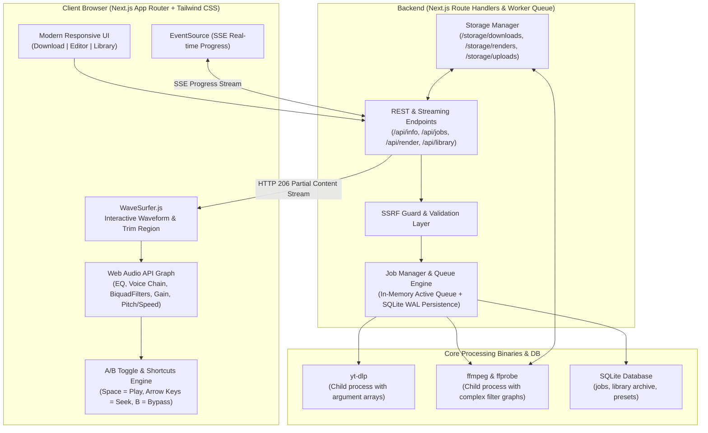

# Video2MP3 🎵
> Production-grade audio extraction, Web Audio DSP mastering, and studio MP3 export suite.

Video2MP3 downloads audio from online video platforms (YouTube and any platform supported by `yt-dlp`) or local media files, converts it into high-fidelity MP3, provides an interactive audio waveform editor with real-time Web Audio API DSP preview, and renders mastered MP3 exports server-side via FFmpeg.

---

## 🏛 Architecture Overview



---

## ✨ Features

### 1. Download & Convert
- **Universal Media URL Ingestion**: YouTube videos and playlists, Vimeo, SoundCloud, and any site supported by `yt-dlp`.
- **Instant Metadata Preview**: View title, high-res thumbnail, duration, and channel before downloading.
- **Selectable MP3 Quality**:
  - `320 kbps CBR` (Audiophile Extreme)
  - `256 kbps CBR` (High Fidelity)
  - `192 kbps CBR` (Standard Web)
  - `128 kbps CBR` (Compact Voice)
  - `VBR V0` (Transparent Variable Bitrate)
- **Real-Time Progress Streaming**: SSE streaming download percentage, transfer speed, and estimated time of arrival (ETA).
- **Local File Upload**: Drag-and-drop video/audio files (`.mp4`, `.mkv`, `.webm`, `.mov`, `.wav`, `.m4a`, `.flac`) for audio extraction.
- **ID3 Tag Preservation**: Automatic tag writing and cover art embedding from video thumbnails.

### 2. Bulk Download & Speed Conversion ⚡
- **Multi-URL Batch Ingestion**: Paste lists of YouTube, SoundCloud, Vimeo, podcasts, or direct media links.
- **Auto-Expanding Playlists**: Automatically detects and expands YouTube playlist links into individual batch items.
- **Single-Pass Speed DSP Processing**: Changes playback speed (0.25x to 4.0x) directly during MP3 encoding with zero lossy double-compression.
- **Natural Pitch Preservation**: WSOLA `atempo` filter graph locks original vocal pitch, avoiding chipmunk distortion, or switch to vinyl resampling mode.
- **Audio Enhancements**: Optional loudness normalization (-16 LUFS) and speech clarity voice enhance across all batch items.
- **Real-Time Progress & Batch Queue**: Concurrent processing queue with live SSE progress tracking for downloads and speed encoding.
- **ZIP Archive Export**: One-click "Download All as ZIP" packaging all completed batch tracks into a single archive, plus inline audio playback and per-track downloads.

### 3. Audio DSP Mastering Editor
- **Interactive Waveform**: Powered by `wavesurfer.js` with timeline, zoom, and loopable region trimming.
- **Instant A/B Testing**: Live toggle between dry original and processed DSP audio (`B` shortcut).
- **Voice Enhance**:
  - High-pass rumble filter (80 Hz).
  - Noise reduction (`afftdn` with adjustable strength).
  - Voice presence boost (~3 kHz peaking EQ).
  - De-esser high-frequency cut (~8 kHz).
  - Voice dynamics compressor (3.5:1 ratio, voice-optimized attack & release).
  - Loudness normalization (-16 LUFS podcast standard, -14 LUFS streaming, -18 LUFS spoken word, -23 LUFS broadcast).
  - Presets: Podcast, Lecture, Phone/Noisy Recording, and Music.
- **10-Band Graphic Equalizer**:
  - Bands at 31, 62, 125, 250, 500, 1k, 2k, 4k, 8k, 16k Hz ($\pm 12\text{ dB}$).
  - Live frequency-response curve canvas drawn in real-time above sliders.
  - Built-in & custom user-saved presets (persisted in SQLite).
- **Speed & Pitch Controls**:
  - Playback speed from 0.25x to 4.0x with quick buttons (0.75x, 1x, 1.25x, 1.5x, 2x).
  - Pitch preservation toggle (time-stretch via chained `atempo` vs resampling).
  - Pitch shift from -12 to +12 semitones.
- **Mastering Tools**:
  - Linear Fade In and Fade Out (seconds).
  - Volume gain (-20 to +20 dB) and peak normalization.
  - Silence removal (threshold dB and minimum duration).
  - Channels: Original, Mono downmix, Stereo.

### 4. Server-Side Export & Library
- **Single Source of Truth**: Shared settings schema ensures server-side FFmpeg output sounds identical to client Web Audio preview.
- **Non-Destructive Versioning**: Original files remain untouched; mastered exports are saved separately with `(Mastered)` lineage tags.
- **Audio Archive & Library**: Searchable catalog, playable audio previews, tag editor, and MP3 downloader.

---

## 📋 Prerequisites

Before running Video2MP3, ensure the following tools are installed on your system:

### 1. Node.js & npm
- **Node.js**: Version `20.x` or `22.x` LTS.
- **npm**: Version `10.x` or higher (bundled with Node.js).
- Verify installation:
  ```bash
  node -v
  npm -v
  ```

### 2. yt-dlp (Required for Video/Audio URL Ingestion)
`yt-dlp` is used to extract media streams, playlist metadata, and audio tracks from YouTube, SoundCloud, Vimeo, and 1,000+ supported online media platforms.

- **macOS** (Homebrew):
  ```bash
  brew install yt-dlp
  ```
- **Linux (Ubuntu / Debian)**:
  ```bash
  sudo apt-get update && sudo apt-get install -y python3-pip
  pip install yt-dlp --break-system-packages
  ```
- **Linux (Arch / Fedora)**:
  ```bash
  # Arch Linux
  sudo pacman -S yt-dlp

  # Fedora
  sudo dnf install yt-dlp
  ```
- **Windows** (winget / Chocolatey):
  ```powershell
  winget install yt-dlp
  # or
  choco install yt-dlp
  ```
- Verify installation:
  ```bash
  yt-dlp --version
  ```

### 3. FFmpeg & FFprobe (Audio Processing Engine)
FFmpeg powers server-side audio extraction, DSP filter graphs (equalizer, voice enhance, pitch/speed modification, loudness normalization), format transcoding to MP3, and ID3 tag / album art embedding.

> [!NOTE]
> Video2MP3 includes fallback static binaries (`ffmpeg-static` and `@ffprobe-installer/ffprobe`), but installing system FFmpeg is strongly recommended for optimal performance, system architecture compatibility, and native codec acceleration.

- **macOS** (Homebrew):
  ```bash
  brew install ffmpeg
  ```
- **Linux (Ubuntu / Debian)**:
  ```bash
  sudo apt-get update && sudo apt-get install -y ffmpeg
  ```
- **Windows** (winget / Chocolatey):
  ```powershell
  winget install Gyan.FFmpeg
  # or
  choco install ffmpeg
  ```
- Verify installation:
  ```bash
  ffmpeg -version
  ffprobe -version
  ```

### 4. Docker & Docker Compose (Optional)
If you prefer running the application in a fully isolated container environment without installing `yt-dlp` or `ffmpeg` directly on your host machine, install [Docker Desktop](https://www.docker.com/products/docker-desktop/) or Docker Engine with Docker Compose.

---

## 🚀 How to Run the Application

### Method 1: Local Development & Production

#### 1. Clone the Repository
```bash
git clone https://github.com/your-username/video2mp3.git
cd video2mp3
```

#### 2. Install Node Dependencies
```bash
npm install
```

#### 3. Configure Environment Variables
Copy the example environment configuration file:
```bash
cp .env.example .env
```
Key configuration parameters in `.env`:
| Variable | Default Value | Description |
| :--- | :--- | :--- |
| `STORAGE_DIR` | `./storage` | Directory where uploads, downloads, and rendered MP3s are kept |
| `DATABASE_PATH` | `./storage/video2mp3.sqlite` | SQLite database file storing job history and presets |
| `YTDLP_PATH` | *(empty)* | Optional absolute path to `yt-dlp` (leave empty for auto-detection in PATH) |
| `FFMPEG_PATH` | *(empty)* | Optional absolute path to `ffmpeg` (leave empty for auto-detection) |
| `FFPROBE_PATH` | *(empty)* | Optional absolute path to `ffprobe` (leave empty for auto-detection) |
| `MAX_FILE_SIZE_MB` | `500` | Maximum allowed local upload file size in megabytes |
| `MAX_DURATION_SECONDS`| `10800` | Maximum media duration in seconds (3 hours) |
| `MAX_CONCURRENT_JOBS` | `3` | Maximum concurrent background download and rendering jobs |
| `JOB_RETENTION_HOURS` | `24` | Auto-cleanup threshold for temporary processing files |

#### 4. Run the Development Server
```bash
npm run dev
```
Open **[http://localhost:3031](http://localhost:3031)** in your browser. The development server supports hot-reloading and live debugging.

> [!TIP]
> If required processing binaries are missing or misconfigured, Video2MP3 displays an interactive alert banner at the top of the interface with exact installation commands for your environment.

#### 5. Build and Run for Production
To build an optimized production bundle and start the server:
```bash
# 1. Build Next.js production bundle
npm run build

# 2. Start the production server
npm run start
```
The production server will be accessible at **[http://localhost:3031](http://localhost:3031)**.

---

### Method 2: Running with Docker (Zero-Config)

Video2MP3 provides a multi-stage `Dockerfile` pre-configured with Node.js 22, FFmpeg, Python 3, and `yt-dlp`:

```bash
# Start container in detached mode (builds automatically if needed)
docker compose up --build -d
```

- Access the application at **[http://localhost:3000](http://localhost:3000)**.
- Media files, SQLite database, and presets persist in the Docker volume named `video2mp3-storage`.

#### Useful Docker Commands:
```bash
# View real-time application logs
docker compose logs -f

# Check container status
docker compose ps

# Stop the container
docker compose down
```

---

## ⌨️ Keyboard Shortcuts

| Shortcut | Action |
| :--- | :--- |
| `Space` | Play / Pause audio playback |
| `←` (Left Arrow) | Rewind 5 seconds |
| `→` (Right Arrow) | Fast-forward 5 seconds |
| `B` | Toggle A/B Bypass (Dry Original vs Processed DSP) |

---

## 🧪 Testing

Video2MP3 includes unit and integration tests covering the FFmpeg filter graph compiler, speed chaining, SSRF security validation, and end-to-end media rendering:

```bash
# Run test suite
npm test
```

---

## 🛡 Security & Limits

- **Process Execution Safety**: Binaries are spawned with explicit argument arrays, never through shell string interpolation.
- **SSRF Protection**: Resolves target hostnames and blocks private/loopback/link-local IPv4 & IPv6 CIDRs before invoking network requests.
- **Resource Quotas**: Configurable via `.env`:
  - `MAX_FILE_SIZE_MB`: Maximum upload size (default: 500 MB).
  - `MAX_CONCURRENT_JOBS`: Maximum simultaneous download/render tasks (default: 3).
  - `JOB_RETENTION_HOURS`: Auto-cleanup threshold for temporary files (default: 24h).

---

## ⚖️ Legal Disclaimer

Video2MP3 is intended strictly for personal archiving, creative fair use, and media production with content that you own, content in the public domain, or content for which you hold explicit permission from the copyright holder.

Downloading audio from online streaming providers may violate the host platform's Terms of Service or copyright laws in your jurisdiction. The end user assumes all legal liability for content ingested, processed, and distributed using this software.
