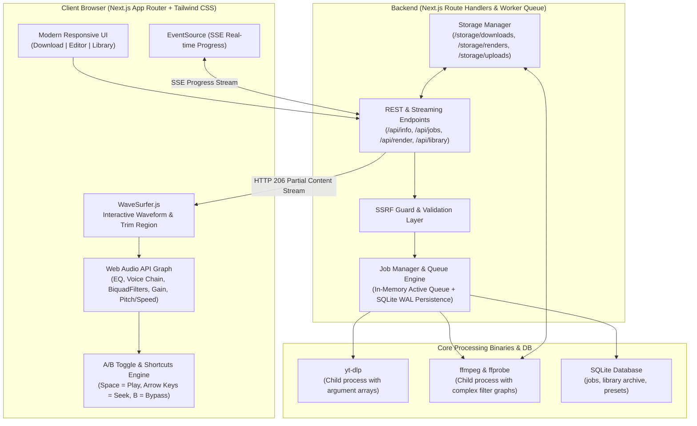

# Video2MP3 🎵
> Production-grade audio extraction, Web Audio DSP mastering, and studio MP3 export suite.

Video2MP3 downloads audio from online video platforms (YouTube and any platform supported by `yt-dlp`) or local media files, converts it into high-fidelity MP3, provides an interactive audio waveform editor with real-time Web Audio API DSP preview, and renders mastered MP3 exports server-side via FFmpeg.

---

## 🏛 Architecture Overview



---

## ✨ Features

### 1. Download & Convert
- **Universal Media URL Ingestion**: YouTube videos and playlists, Vimeo, SoundCloud, and any site supported by `yt-dlp`.
- **Instant Metadata Preview**: View title, high-res thumbnail, duration, and channel before downloading.
- **Selectable MP3 Quality**:
  - `320 kbps CBR` (Audiophile Extreme)
  - `256 kbps CBR` (High Fidelity)
  - `192 kbps CBR` (Standard Web)
  - `128 kbps CBR` (Compact Voice)
  - `VBR V0` (Transparent Variable Bitrate)
- **Real-Time Progress Streaming**: SSE streaming download percentage, transfer speed, and estimated time of arrival (ETA).
- **Local File Upload**: Drag-and-drop video/audio files (`.mp4`, `.mkv`, `.webm`, `.mov`, `.wav`, `.m4a`, `.flac`) for audio extraction.
- **ID3 Tag Preservation**: Automatic tag writing and cover art embedding from video thumbnails.

### 2. Audio DSP Mastering Editor
- **Interactive Waveform**: Powered by `wavesurfer.js` with timeline, zoom, and loopable region trimming.
- **Instant A/B Testing**: Live toggle between dry original and processed DSP audio (`B` shortcut).
- **Voice Enhance**:
  - High-pass rumble filter (80 Hz).
  - Noise reduction (`afftdn` with adjustable strength).
  - Voice presence boost (~3 kHz peaking EQ).
  - De-esser high-frequency cut (~8 kHz).
  - Voice dynamics compressor (3.5:1 ratio, voice-optimized attack & release).
  - Loudness normalization (-16 LUFS podcast standard, -14 LUFS streaming, -18 LUFS spoken word, -23 LUFS broadcast).
  - Presets: Podcast, Lecture, Phone/Noisy Recording, and Music.
- **10-Band Graphic Equalizer**:
  - Bands at 31, 62, 125, 250, 500, 1k, 2k, 4k, 8k, 16k Hz ($\pm 12\text{ dB}$).
  - Live frequency-response curve canvas drawn in real-time above sliders.
  - Built-in & custom user-saved presets (persisted in SQLite).
- **Speed & Pitch Controls**:
  - Playback speed from 0.25x to 4.0x with quick buttons (0.75x, 1x, 1.25x, 1.5x, 2x).
  - Pitch preservation toggle (time-stretch via chained `atempo` vs resampling).
  - Pitch shift from -12 to +12 semitones.
- **Mastering Tools**:
  - Linear Fade In and Fade Out (seconds).
  - Volume gain (-20 to +20 dB) and peak normalization.
  - Silence removal (threshold dB and minimum duration).
  - Channels: Original, Mono downmix, Stereo.

### 3. Server-Side Export & Library
- **Single Source of Truth**: Shared settings schema ensures server-side FFmpeg output sounds identical to client Web Audio preview.
- **Non-Destructive Versioning**: Original files remain untouched; mastered exports are saved separately with `(Mastered)` lineage tags.
- **Audio Archive & Library**: Searchable catalog, playable audio previews, tag editor, and MP3 downloader.

---

## 🚀 Quick Start

### Prerequisites
- [Node.js](https://nodejs.org/) (v20+ or v22+)
- [FFmpeg](https://ffmpeg.org/) (included statically via `ffmpeg-static` or installable via system package manager)
- [yt-dlp](https://github.com/yt-dlp/yt-dlp)

```bash
# macOS
brew install ffmpeg yt-dlp

# Ubuntu / Debian
sudo apt-get update && sudo apt-get install -y ffmpeg python3-pip
pip install yt-dlp --break-system-packages
```

### Local Setup

```bash
# 1. Clone repository
git clone https://github.com/your-username/video2mp3.git
cd video2mp3

# 2. Install dependencies
npm install

# 3. Configure environment
cp .env.example .env

# 4. Run development server
npm run dev
```

Open [http://localhost:3000](http://localhost:3000) (or `http://localhost:3030` if port 3000 is occupied).

### Running with Docker

```bash
docker compose up --build -d
```
Access the application at [http://localhost:3000](http://localhost:3000). All media and SQLite databases are persisted in the `video2mp3-storage` volume.

---

## ⌨️ Keyboard Shortcuts

| Shortcut | Action |
| :--- | :--- |
| `Space` | Play / Pause audio playback |
| `←` (Left Arrow) | Rewind 5 seconds |
| `→` (Right Arrow) | Fast-forward 5 seconds |
| `B` | Toggle A/B Bypass (Dry Original vs Processed DSP) |

---

## 🧪 Testing

Video2MP3 includes unit and integration tests covering the FFmpeg filter graph compiler, speed chaining, SSRF security validation, and end-to-end media rendering:

```bash
# Run test suite
npm test
```

---

## 🛡 Security & Limits

- **Process Execution Safety**: Binaries are spawned with explicit argument arrays, never through shell string interpolation.
- **SSRF Protection**: Resolves target hostnames and blocks private/loopback/link-local IPv4 & IPv6 CIDRs before invoking network requests.
- **Resource Quotas**: Configurable via `.env`:
  - `MAX_FILE_SIZE_MB`: Maximum upload size (default: 500 MB).
  - `MAX_CONCURRENT_JOBS`: Maximum simultaneous download/render tasks (default: 3).
  - `JOB_RETENTION_HOURS`: Auto-cleanup threshold for temporary files (default: 24h).

---

## ⚖️ Legal Disclaimer

Video2MP3 is intended strictly for personal archiving, creative fair use, and media production with content that you own, content in the public domain, or content for which you hold explicit permission from the copyright holder.

Downloading audio from online streaming providers may violate the host platform's Terms of Service or copyright laws in your jurisdiction. The end user assumes all legal liability for content ingested, processed, and distributed using this software.
